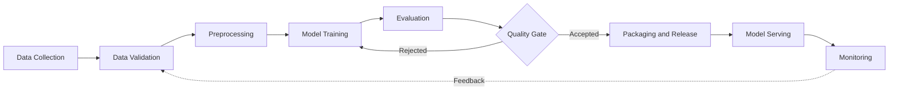
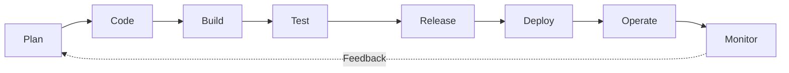
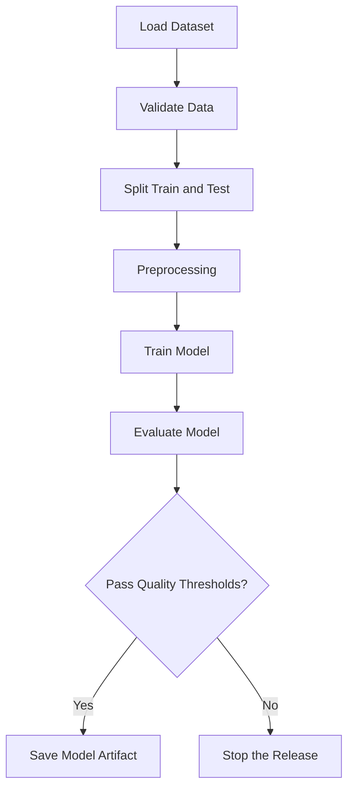
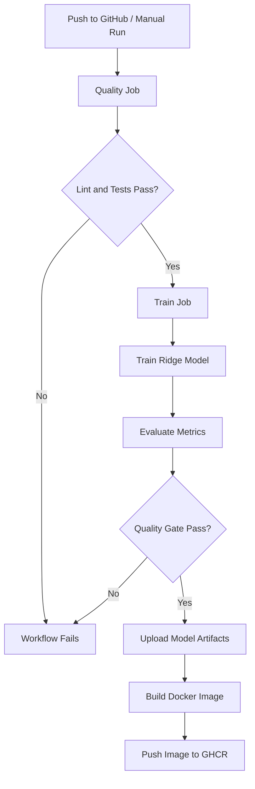
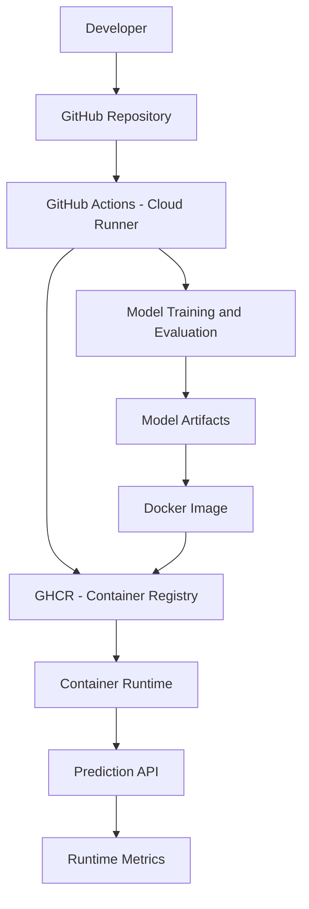

<div align="center">

# House Price Prediction | MLOps Project

### از کد و داده تا آموزش مدل، کنترل کیفیت، ساخت کانتینر و ارائه سرویس پیش‌بینی

**A practical, lightweight MLOps workflow for house-price prediction**

</div>

---

## فهرست مطالب

1. [MLOps چیست؟](#1-mlops-چیست)
2. [MLOps و DevOps؛ تفاوت‌ها و شباهت‌ها](#2-mlops-و-devops-تفاوتها-و-شباهتها)
3. [Pipeline چیست؟](#3-pipeline-چیست)
4. [CI/CD چیست و چه نقشی دارد؟](#4-cicd-چیست-و-چه-نقشی-دارد)
5. [نقش رایانش ابری در MLOps](#5-نقش-رایانش-ابری-در-mlops)
6. [پروژه عملی: House Price Prediction](#6-پروژه-عملی-house-price-prediction)
7. [راه‌اندازی و اجرای پروژه](#7-راهاندازی-و-اجرای-پروژه)
8. [محدودیت‌ها و دامنه فعلی پروژه](#8-محدودیتها-و-دامنه-فعلی-پروژه)

---

# 1. MLOps چیست؟

**MLOps** کوتاه‌شده‌ی *Machine Learning Operations* است. این مفهوم مجموعه‌ای از اصول، فرایندها و ابزارها برای استانداردسازی و خودکارسازی چرخه عمر سیستم‌های یادگیری ماشین است؛ از آماده‌سازی داده و آموزش مدل تا ارزیابی، بسته‌بندی، ارائه سرویس و پایش عملکرد آن.

در یک پروژه آزمایشی ممکن است یک مدل را در Notebook آموزش دهیم و معیارهای آن را مشاهده کنیم. اما برای استفاده قابل اتکا از مدل، فقط آموزش کافی نیست. باید بتوانیم مشخص کنیم:

- مدل با کدام نسخه از کد و داده آموزش دیده است؟
- از چه پارامترها و تنظیماتی استفاده شده است؟
- عملکرد مدل چگونه ارزیابی شده و چه معیاری برای پذیرش آن وجود دارد؟
- چگونه مدل را به‌شکل قابل تکرار در قالب یک سرویس ارائه می‌کنیم؟
- پس از اجرا، چگونه وضعیت سرویس و خطاهای آن را بررسی می‌کنیم؟

MLOps تلاش می‌کند این فعالیت‌ها را به یک فرایند منظم، قابل ردیابی و تا حد امکان خودکار تبدیل کند.

### چرخه عمر معمول MLOps




### اهداف اصلی MLOps

| هدف | توضیح |
|---|---|
| Automation | کاهش کارهای دستی در آموزش، آزمون و انتشار |
| Reproducibility | امکان بازتولید فرایند و نتایج با تنظیمات مشخص |
| Experiment Tracking | ثبت پارامترها، معیارها و سابقه آزمایش‌ها |
| Quality Control | جلوگیری از انتشار مدلی که معیارهای کیفیت را برآورده نمی‌کند |
| Model Serving | ارائه مدل از طریق یک رابط قابل استفاده، مانند API |
| Monitoring | مشاهده وضعیت سرویس و شناسایی خطاها و مشکلات عملیاتی |

---

# 2. MLOps و DevOps؛ تفاوت‌ها و شباهت‌ها

**DevOps** مجموعه‌ای از فرهنگ‌ها و روش‌های توسعه نرم‌افزار و عملیات است که همکاری بین تیم‌های توسعه و عملیات را تقویت می‌کند. هدف آن کوتاه‌تر کردن چرخه تحویل نرم‌افزار، خودکارسازی فرایندها و افزایش قابلیت اطمینان انتشارهاست.

**MLOps** بسیاری از اصول DevOps را در چرخه یادگیری ماشین به‌کار می‌گیرد، اما علاوه بر کد نرم‌افزار باید با داده، آزمایش‌ها، مدل‌های آموزش‌دیده و تغییر رفتار مدل در طول زمان نیز سروکار داشته باشد.

### چرخه معمول DevOps



### شباهت‌های MLOps و DevOps

- هر دو از کنترل نسخه برای مدیریت تغییرات استفاده می‌کنند.
- هر دو به تست خودکار و کنترل کیفیت متکی هستند.
- هر دو از CI/CD برای استانداردسازی فرایند ساخت و انتشار بهره می‌برند.
- هر دو به خودکارسازی، قابلیت تکرار، همکاری تیمی و پایش نیاز دارند.
- در هر دو، هدف کاهش خطای انسانی و قابل اعتمادتر کردن فرایند تحویل است.

### تفاوت‌های اصلی

| موضوع | DevOps | MLOps |
|---|---|---|
| خروجی اصلی | نسخه‌ای از نرم‌افزار | مدل یادگیری ماشین و سرویس وابسته به آن |
| اقلام تحت کنترل نسخه | کد، تنظیمات و زیرساخت | کد، داده، تنظیمات آموزش، مدل و معیارها |
| آزمون | آزمون واحد، یکپارچگی و عملکرد نرم‌افزار | آزمون کد به‌علاوه ارزیابی کیفیت و عملکرد مدل |
| عامل تغییر | تغییر کد، تنظیمات یا زیرساخت | تغییر کد، داده، ویژگی‌ها یا رفتار آماری داده |
| معیار کیفیت | صحت، امنیت، کارایی و پایداری نرم‌افزار | معیارهای نرم‌افزار به‌علاوه معیارهای مدل مانند MAE و RMSE |
| پایش | سلامت سرویس، خطاها، منابع و زمان پاسخ | سلامت سرویس و در سامانه‌های کامل‌تر کیفیت داده و عملکرد مدل |

**جمع‌بندی:** MLOps جایگزین DevOps نیست؛ بلکه اصول DevOps را با نیازهای ویژه چرخه یادگیری ماشین گسترش می‌دهد.

---

# 3. Pipeline چیست؟

در مهندسی نرم‌افزار و یادگیری ماشین، **Pipeline** زنجیره‌ای از مراحل مشخص و مرتب است که داده یا خروجی هر مرحله را به مرحله بعد منتقل می‌کند. هر مرحله وظیفه مشخصی دارد و می‌تواند تنها پس از موفقیت مرحله‌های پیش‌نیاز اجرا شود.

برای مثال، در یک فرایند آموزش مدل، ابتدا داده دریافت می‌شود، سپس داده‌ها آماده‌سازی می‌شوند، مدل آموزش می‌بیند و در نهایت کیفیت آن ارزیابی می‌شود.

### نمونه یک Machine Learning Pipeline



### چرا Pipeline اهمیت دارد؟

1. **ترتیب مشخص:** مراحل به ترتیب تعریف‌شده اجرا می‌شوند.
2. **قابلیت تکرار:** ورودی‌ها، تنظیمات و مراحل مشخص هستند.
3. **خودکارسازی:** اجرای مجدد فرایند به دخالت دستی کمتری نیاز دارد.
4. **ردیابی خطا:** مشخص می‌شود شکست در کدام مرحله رخ داده است.
5. **کنترل کیفیت:** می‌توان پیش از انتشار، معیارهای پذیرش را بررسی کرد.

در این پروژه دو نوع Pipeline را از هم تفکیک می‌کنیم:

- **ML Pipeline:** دریافت داده، پیش‌پردازش، آموزش، ارزیابی و ذخیره مدل.
- **CI/CD Pipeline:** بررسی کد، اجرای تست‌ها، اجرای فرایند آموزش، کنترل کیفیت، ساخت Docker Image و انتشار آن در Registry.

---

# 4. CI/CD چیست و چه نقشی دارد؟

**CI/CD** مجموعه‌ای از روش‌ها برای خودکارسازی بررسی، ساخت، آزمون و تحویل نرم‌افزار است. این اصطلاح معمولاً به سه مفهوم مرتبط اشاره می‌کند:

### Continuous Integration (CI) | یکپارچه‌سازی مداوم

تغییرات کد به‌صورت پیوسته وارد مخزن مشترک می‌شوند و پس از هر تغییر، بررسی‌های خودکار اجرا می‌شوند. هدف این است که خطاهای کد و ناسازگاری‌ها زودتر شناسایی شوند.

نمونه فعالیت‌های CI در این پروژه:

- دریافت کد از GitHub
- نصب وابستگی‌های پروژه
- اجرای Ruff برای بررسی کیفیت و قالب واردکردن کتابخانه‌ها
- اجرای تست‌ها با Pytest

### Continuous Delivery | تحویل مداوم

پس از موفقیت آزمون‌ها، خروجی نرم‌افزار یا بسته قابل انتشار آماده می‌شود. انتشار نهایی می‌تواند همچنان به تأیید یا اقدام دستی نیاز داشته باشد.

### Continuous Deployment | استقرار مداوم

در این حالت، تغییرات تأییدشده بدون دخالت دستی به محیط اجرایی منتقل می‌شوند. بنابراین هر استقرار خودکار، نوعی تحویل خودکار است؛ اما هر تحویل خودکار الزاماً به معنی استقرار خودکار نیست.

### CI/CD در پروژه حاضر



در Workflow اصلی پروژه:

| Job | وظیفه |
|---|---|
| `quality` | نصب پروژه، اجرای Lint و تست‌ها |
| `train` | آموزش مدل، ارزیابی و اجرای Quality Gate |
| `build-and-push` | دریافت Artifact مدل، ساخت Image و انتشار در GHCR |

شرط‌های اجرای Workflow نیز اهمیت دارند:

- در Pull Request، مرحله بررسی کیفیت اجرا می‌شود؛ آموزش و انتشار Image اجرا نمی‌شوند.
- در Push به شاخه `main`، پس از موفقیت مرحله‌های قبلی، Image ساخته و منتشر می‌شود.
- اجرای دستی Workflow نیز از طریق GitHub Actions امکان‌پذیر است.

**وضعیت CD در این پروژه:** فرایند ساخت و انتشار Docker Image در GHCR خودکار است. اجرای کانتینر در Codespaces برای نمایش عملی به‌صورت دستی انجام می‌شود؛ در این نسخه، استقرار خودکار روی یک میزبان ابری دائمی پیاده‌سازی نشده است.

---

# 5. نقش رایانش ابری در MLOps

رایانش ابری منابع پردازشی، فضای ذخیره‌سازی، محیط توسعه، ابزارهای خودکارسازی و سرویس‌های میزبانی را از طریق اینترنت فراهم می‌کند. این قابلیت‌ها اجرای چرخه MLOps را ساده‌تر می‌کنند، به‌ویژه زمانی که تیم به منابع محاسباتی یا زیرساخت اختصاصی نیاز دارد.

### نقش‌های رایانش ابری در چرخه MLOps

| قابلیت ابری | کاربرد در MLOps |
|---|---|
| Cloud Development Environment | توسعه پروژه در محیطی مستقل از سخت‌افزار شخصی |
| Cloud Compute | اجرای آموزش و پردازش داده روی منابع محاسباتی ابری |
| Cloud Storage | نگهداری داده‌ها، مدل‌ها و Artifactها |
| CI/CD Runners | اجرای خودکار تست، آموزش و ساخت بسته |
| Container Registry | ذخیره و توزیع Docker Image |
| Model/API Hosting | اجرای مدل و ارائه سرویس پیش‌بینی |
| Monitoring Services | جمع‌آوری Log، معیارهای سرویس و رخدادها |

### نمای ساده ارتباط رایانش ابری با MLOps




### سرویس‌های ابری مورد استفاده در این پروژه

- **GitHub Codespaces:** محیط توسعه ابری برای کار با مخزن و اجرای Docker.
- **GitHub Actions:** Runnerهای ابری برای اجرای Workflow و مراحل CI/CD.
- **GitHub Container Registry (GHCR):** نگهداری و انتشار Docker Image.

در این پروژه، اجرای API در Codespaces برای نمایش و آزمایش انجام می‌شود. Codespaces محیط توسعه و اجرای موقت است و نباید با میزبانی دائمی و Production یکسان در نظر گرفته شود.

---

# 6. پروژه عملی: House Price Prediction

## 6.1 معرفی پروژه

این پروژه یک نمونه سبک و آموزشی از پیاده‌سازی چرخه MLOps برای پیش‌بینی قیمت خانه است. هدف اصلی، ساخت پیچیده‌ترین مدل ممکن نیست؛ هدف نمایش ارتباط میان آموزش مدل، ارزیابی، کنترل کیفیت، مدیریت Artifact، بسته‌بندی کانتینری، انتشار Image و ارائه API است.

برای ساده و قابل اجرا ماندن پروژه، از الگوریتم **Ridge Regression** در کتابخانه Scikit-learn استفاده شده است. این مدل به GPU نیاز ندارد و برای نمایش مفاهیم اصلی MLOps مناسب است.

### هدف سیستم

دریافت ویژگی‌های یک منطقه مسکونی و برگرداندن مقدار پیش‌بینی‌شده قیمت خانه با استفاده از مدل آموزش‌دیده.

## 6.2 دیتاست و ویژگی‌ها

از دیتاست **California Housing** موجود در Scikit-learn استفاده می‌شود. این دیتاست شامل ویژگی‌های آماری مناطق کالیفرنیا و مقدار میانه ارزش خانه‌ها در آن مناطق است.

ویژگی‌های مورد استفاده مدل:

| ویژگی | توضیح |
|---|---|
| `MedInc` | میانه درآمد خانوارها |
| `HouseAge` | میانه سن خانه‌ها |
| `AveRooms` | میانگین تعداد اتاق‌ها |
| `AveBedrms` | میانگین تعداد اتاق‌خواب‌ها |
| `Population` | جمعیت منطقه |
| `AveOccup` | میانگین تعداد ساکنان خانوار |
| `Latitude` | عرض جغرافیایی |
| `Longitude` | طول جغرافیایی |

مقدار هدف دیتاست با مقیاس **۱۰۰٬۰۰۰ دلار** بیان می‌شود. بنابراین خروجی خام مدل باید با همین مقیاس تفسیر شود.

## 6.3 فرایند آموزش مدل

فرایند آموزش در ماژول زیر قرار دارد:

```text
src/houseprice_mlops/pipelines/train.py
```

مراحل اصلی:

1. دریافت دیتاست California Housing.
2. جداسازی داده به مجموعه‌های آموزش و آزمون با نسبت ۸۰ به ۲۰.
3. مدیریت مقادیر گمشده با `SimpleImputer` و راهبرد میانه.
4. مقیاس‌بندی ویژگی‌ها با `StandardScaler`.
5. آموزش مدل `Ridge` با `alpha=1.0`.
6. محاسبه معیارهای MAE و RMSE.
7. ثبت پارامترها و معیارهای آزمایش در MLflow.
8. ذخیره مدل و فایل معیارها در پوشه `artifacts/`.

تنظیمات تقسیم داده در نسخه فعلی با `random_state=42` ثابت شده‌اند تا اجرای مجدد قابل مقایسه باشد.

## 6.4 ارزیابی مدل و Quality Gate

برای ارزیابی از دو معیار استفاده می‌شود:

- **MAE (Mean Absolute Error):** میانگین قدرمطلق اختلاف مقدار واقعی و پیش‌بینی‌شده.
- **RMSE (Root Mean Squared Error):** ریشه میانگین مربعات خطا؛ نسبت به خطاهای بزرگ حساسیت بیشتری دارد.

در Quality Gate آستانه‌های زیر تعریف شده‌اند:

| معیار | آستانه پذیرش |
|---|---:|
| MAE | حداکثر `0.60` |
| RMSE | حداکثر `0.85` |

ماژول کنترل کیفیت:

```text
src/houseprice_mlops/evaluation/quality_gate.py
```

اگر فایل مدل یا معیارها وجود نداشته باشد، یا معیارها از آستانه‌های تعیین‌شده عبور کنند، فرایند با وضعیت ناموفق متوقف می‌شود. به این ترتیب مدل نامعتبر به مرحله بسته‌بندی نمی‌رسد.

یک اجرای ثبت‌شده قبلی، نتایج زیر را داشته است. مقادیر اجرای جدید نیز باید از خروجی همان Run بررسی شوند:

| معیار | نتیجه ثبت‌شده |
|---|---:|
| MAE | `0.5332` |
| RMSE | `0.7456` |
| تعداد نمونه آموزش | `16,512` |
| تعداد نمونه آزمون | `4,128` |

این مقادیر به مقیاس هدف دیتاست هستند؛ برای تفسیر تقریبی به دلار، مقدار خطا در ۱۰۰٬۰۰۰ ضرب می‌شود.

## 6.5 Experiment Tracking با MLflow

MLflow برای ثبت جزئیات آزمایش آموزش مدل استفاده شده است؛ از جمله:

- نام Experiment: `house-price-baseline`
- نوع مدل: Ridge Regression
- مقدار `alpha`
- نسبت داده‌های آموزش و آزمون
- `random_state`
- تعداد ویژگی‌ها
- معیارهای MAE و RMSE

فایل پایگاه داده ردیابی در مسیر زیر تولید می‌شود:

```text
artifacts/mlflow/mlflow.db
```

این فایل و سایر خروجی‌های آموزش در مخزن Git نگهداری نمی‌شوند؛ خروجی‌ها در GitHub Actions به‌عنوان Artifact بارگذاری می‌شوند.


## 6.7 ساختار پوشه‌های پروژه

ساختار اصلی پروژه به‌صورت زیر است. پوشه `artifacts/` هنگام اجرای آموزش تولید می‌شود و به دلیل حجم و ماهیت خروجی‌های تولیدشده، در Git نادیده گرفته شده است.

```text
house-mlops/
│
├── .github/
│   └── workflows/
│       ├── pipeline.yml
│       ├── ci.yml
│       └── train.yml
│
├── src/
│   └── houseprice_mlops/
│       ├── __init__.py
│       ├── api.py
│       │
│       ├── evaluation/
│       │   └── quality_gate.py
│       │
│       ├── monitoring/
│       │   ├── __init__.py
│       │   └── metrics.py
│       │
│       └── pipelines/
│           └── train.py
│
├── tests/
│   └── ...
│
├── artifacts/                    # Generated; excluded from Git
│   ├── baseline_model.joblib
│   ├── metrics.json
│   └── mlflow/
│       └── mlflow.db
│
├── Dockerfile
├── Makefile
├── pyproject.toml
├── .gitignore
└── README.md
```

### نقش فایل‌ها و پوشه‌ها

| مسیر | مسئولیت |
|---|---|
| `.github/workflows/pipeline.yml` | Workflow اصلی شامل کیفیت کد، آموزش مدل و ساخت/انتشار Image |
| `.github/workflows/ci.yml` | Workflow مستقل بررسی کیفیت و تست‌ها |
| `.github/workflows/train.yml` | Workflow دستی آموزش مدل |
| `src/houseprice_mlops/pipelines/train.py` | دریافت داده، پیش‌پردازش، آموزش، ارزیابی و ذخیره خروجی‌ها |
| `src/houseprice_mlops/evaluation/quality_gate.py` | بررسی وجود Artifactها و پذیرش یا رد مدل بر اساس MAE و RMSE |
| `src/houseprice_mlops/api.py` | تعریف FastAPI، اعتبارسنجی ورودی و ارائه Endpointهای سرویس |
| `src/houseprice_mlops/monitoring/metrics.py` | شمارش درخواست‌ها، خطاها، کدهای وضعیت و میانگین زمان پاسخ |
| `Dockerfile` | ساخت Image شامل برنامه API و فایل مدل |
| `pyproject.toml` | مشخصات پکیج، وابستگی‌ها و تنظیمات ابزارهای توسعه |
| `Makefile` | میانبر اجرای نصب، Lint، تست و پاک‌سازی |
| `artifacts/` | خروجی‌های تولیدشده توسط فرایند آموزش؛ در Git ثبت نمی‌شود |

> نام و وجود فایل‌های فرعی مثل تست‌ها ممکن است با نسخه جاری مخزن تغییر کند. این نمودار ساختار اصلی شناخته‌شده پروژه را مستند می‌کند.

## 6.8 ساخت Docker Image و انتشار در GHCR

در مرحله Build، فایل `Dockerfile` محیط اجرای برنامه را آماده می‌کند:

- استفاده از Image پایه `python:3.12-slim`
- نصب پروژه و وابستگی‌های API
- کپی کد منبع برنامه
- کپی مدل آموزش‌دیده به مسیر مورد انتظار سرویس در کانتینر
- اجرای Uvicorn برای راه‌اندازی FastAPI روی پورت `8000`

Image در GitHub Container Registry منتشر می‌شود:

```text
ghcr.io/mahdiagheli/house-price-api:latest
```

همچنین Image با شناسه Commit نیز برچسب‌گذاری می‌شود تا نسخه ساخته‌شده از تغییر مشخصی از کد قابل شناسایی باشد.

## 6.9 سرویس پیش‌بینی با FastAPI

API در فایل زیر پیاده‌سازی شده است:

```text
src/houseprice_mlops/api.py
```

مدل هنگام راه‌اندازی برنامه از داخل کانتینر بارگذاری می‌شود. درخواست پیش‌بینی با Pydantic اعتبارسنجی می‌شود و سپس داده ورودی به مدل Scikit-learn تحویل داده می‌شود.

### Endpointهای سرویس

| Endpoint | روش | کاربرد |
|---|---|---|
| `/health` | GET | بررسی در دسترس بودن سرویس |
| `/predict` | POST | دریافت ویژگی‌های خانه و برگرداندن پیش‌بینی |
| `/metrics` | GET | برگرداندن معیارهای ساده اجرای سرویس |
| `/docs` | GET | مستندات تعاملی Swagger UI |

نمونه ورودی برای `/predict`:

```json
{
  "MedInc": 8.3252,
  "HouseAge": 41,
  "AveRooms": 6.9841,
  "AveBedrms": 1.0238,
  "Population": 322,
  "AveOccup": 2.5556,
  "Latitude": 37.88,
  "Longitude": -122.23
}
```

پاسخ، مقدار پیش‌بینی‌شده را همراه با اطلاعات واحد پول و مقیاس قیمت برمی‌گرداند.


## 6.10 Runtime Monitoring

برای پایش ساده سرویس، یک کلاس `RequestMonitor` پیاده‌سازی شده است. Middleware در API زمان و نتیجه درخواست‌ها را ثبت می‌کند.

خروجی `/metrics` شامل موارد زیر است:

- `total_requests`: تعداد کل درخواست‌ها
- `total_errors`: تعداد درخواست‌های ناموفق با کد وضعیت ۴۰۰ یا بالاتر
- `error_rate`: نسبت درخواست‌های ناموفق به کل درخواست‌ها
- `average_latency_seconds`: میانگین زمان پاسخ‌گویی
- `status_codes`: تعداد پاسخ‌ها به تفکیک کد وضعیت

این پیاده‌سازی برای نمایش مفهوم Runtime Monitoring مناسب است، اما داده‌ها در حافظه فرایند نگهداری می‌شوند؛ بنابراین با Restart شدن کانتینر پاک خواهند شد و برای پایش Production یا چند Replica طراحی نشده‌اند.


---

# 7. راه‌اندازی و اجرای پروژه

## 7.1 پیش‌نیازها

برای اجرای کامل مراحل توسعه و آموزش:

- Python 3.11 یا بالاتر
- Git
- Docker Engine
- دسترسی شبکه برای دریافت دیتاست و وابستگی‌ها

برای اجرای Image منتشرشده فقط Docker لازم است.

## 7.2 دریافت مخزن

```bash
git clone https://github.com/mahdiagheli/house-mlops.git
cd house-mlops
```

## 7.3 نصب وابستگی‌ها و بررسی کیفیت

```bash
make install
make check
```

## 7.4 اجرای آموزش و کنترل کیفیت مدل

```bash
python -m houseprice_mlops.pipelines.train
python -m houseprice_mlops.evaluation.quality_gate
```

پس از اجرای موفق، خروجی‌های مدل و معیارها در `artifacts/` قرار می‌گیرند.

## 7.5 دریافت و اجرای Docker Image منتشرشده

```bash
docker pull ghcr.io/mahdiagheli/house-price-api:latest
```

```bash
docker run -d \
  --name house-price-service \
  -p 8000:8000 \
  ghcr.io/mahdiagheli/house-price-api:latest
```

بررسی وضعیت کانتینر:

```bash
docker ps
```

بررسی سلامت API:

```bash
curl http://localhost:8000/health
```

پس از اجرا، آدرس‌های محلی سرویس:

- Swagger UI: `http://localhost:8000/docs`
- Health: `http://localhost:8000/health`
- Metrics: `http://localhost:8000/metrics`

در GitHub Codespaces باید پورت `8000` را از تب **Ports** باز کرد و URL تولیدشده توسط Codespaces را به‌کار برد؛ آدرس عمومی Codespaces با `localhost` یکسان نیست.

## 7.6 مدیریت کانتینر

```bash
# Stop

docker stop house-price-service

# Start the existing container again

docker start house-price-service

# Restart

docker restart house-price-service

# View logs

docker logs -f house-price-service

# Remove the container (does not remove the image)

docker rm -f house-price-service
```

---

# 8. محدودیت‌ها و دامنه فعلی پروژه

این پروژه با هدف آموزشی و نمایش مفاهیم اصلی MLOps طراحی شده است. برای ارزیابی صحیح باید بین قابلیت‌های پیاده‌سازی‌شده و قابلیت‌های پیشرفته‌ای که در این نسخه وجود ندارند تفاوت قائل شد.

### قابلیت‌های پیاده‌سازی‌شده

- مدیریت کد با Git و GitHub
- اجرای خودکار بررسی کیفیت و تست‌ها با GitHub Actions
- آموزش مدل در Runner ابری GitHub Actions
- ارزیابی مدل با MAE و RMSE
- کنترل پذیرش مدل با Quality Gate
- ثبت پارامترها و معیارهای آزمایش در MLflow
- ذخیره Artifactهای آموزش در GitHub Actions
- ساخت Docker Image به‌صورت خودکار
- انتشار Image در GHCR با تگ `latest` و تگ Commit
- ارائه مدل از طریق FastAPI
- نمایش آمار ساده درخواست‌ها و خطاها

### خارج از دامنه این نسخه

- استقرار خودکار روی سرویس میزبانی ابری دائمی
- Kubernetes و Orchestration چندکانتینری
- پایگاه داده دائمی برای Runtime Metrics
- سامانه متمرکز Log و Alerting
- پایش Data Drift و Model Drift
- چرخه خودکار Retraining بر اساس داده‌های جدید
- Model Registry مستقل و فرایند تأیید چندمرحله‌ای مدل در محیط Production

در نسخه فعلی، Docker Image در GHCR منتشر می‌شود و کانتینر برای نمایش عملی در Codespaces به‌صورت دستی اجرا می‌شود. بنابراین این پروژه فرایند خودکار CI، آموزش و ارزیابی مدل و Build/Publish کانتینر را نمایش می‌دهد، اما Continuous Deployment روی یک میزبان دائمی را ادعا نمی‌کند.

---

## فناوری‌های مورد استفاده

| حوزه | ابزار |
|---|---|
| زبان برنامه‌نویسی | Python |
| پردازش داده و مدل‌سازی | Pandas, NumPy, Scikit-learn |
| مدل | Ridge Regression |
| Experiment Tracking | MLflow |
| API | FastAPI, Uvicorn, Pydantic |
| تست | Pytest |
| بررسی کیفیت کد | Ruff |
| Containerization | Docker |
| Container Registry | GitHub Container Registry (GHCR) |
| CI/CD | GitHub Actions |
| محیط توسعه ابری | GitHub Codespaces |


<div align="center">

**House Price Prediction | MLOps Demonstration Project**

</div>
